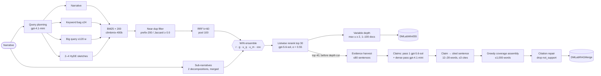

<div align="center">

# 🔎 DM-Lab-RAG-2026

### Multi-Query Retrieval, Ensemble Judging, and Claim-Pack Generation for the TREC 2026 RAG Track

[](https://github.com/marif561/TREC-RAG_2026/actions/workflows/ci.yml)


-orange)


**Elyas Irankhah\*, Muhammad Arif\*, Sreeraj Ramachandran, Samah Fodeh-Jarad**  
Department of Emergency Medicine, Yale University School of Medicine  
<sub>\* co-corresponding authors</sub>

</div>

---

Two fully automatic systems for the TREC 2026 Retrieval-Augmented Generation track:

| Run | Task | Idea |
|---|---|---|
| **DMLabWin055** | Retrieval | Up to 7 lexical query views → BM25 → dedup → RRF → three LLM judges → listwise rerank → *adaptive* depth |
| **DMLabRAGMerge** | Generation | Harvest evidence → extract atomic, evidence-linked claims → one cited sentence per claim → coverage-greedy assembly → citation repair |

> **About this repository.** This is a clean, modular, tested re-implementation of the methods described in the paper, with every frozen parameter and every prompt taken from it. The code that produced the officially submitted runs is at **[Elyasirankhah/TREC-RAG-2026](https://github.com/Elyasirankhah/TREC-RAG-2026)**. Use that repository to reproduce the submitted files exactly.

## 🏆 Highlights

- **Precision with less effort.** Set precision of **0.455** against a field median of 0.350 (+30%), while submitting **42.5% fewer documents** than the median run.
- **Strong coverage.** Manual nugget gain of **0.910**, which matched the best reported score on **13 of 25** narratives.
- **No custom index.** All retrieval is BM25 over the shared `climbmix-400b` index; the gains come from query diversity and LLM judging.
- **Honest negatives.** The claim-first generator was strong on facts but weaker on synthesis and citation coverage. The paper reports this, and so does this README.

## 🧭 Architecture



### Ensemble weights (frozen on development, Table 2)

| Signal | Source | Weight |
|---|---|---:|
| `r` | Rank percentile after fusion | 0.3 |
| `g` | gpt-4.1-mini pointwise grade (0–100) | 0.1 |
| `u_q` | UMBRELA grade, Qwen3.5-9B (0–4) | 0.4 |
| `u_m` | UMBRELA grade, Ministral-3-14B (0–4) | 0.1 |
| `cov` | Coverage pseudo-UMBRELA | 0.1 |

At test time the coverage cache is absent, so its weight is redistributed proportionally over the remaining signals. Inside the listwise head, `s(d) = 0.55 · pct_list(d) + 0.45 · pct_ens(d)`.

## 📊 Results

### Official TREC 2026 retrieval evaluation (DMLabWin055)

| Metric | DM-Lab | Median | Max |
|---|---:|---:|---:|
| Set precision (82 topics) | **0.455** | 0.350 | 0.730 |
| Set recall (82) | **0.118** | 0.100 | 0.548 |
| Documents submitted (82) | **57.5** | 100 | 4542 |
| Manual nugget gain (25) | **0.910** | 0.897 | 0.984 |
| Automatic nugget gain (25) | **0.687** | 0.627 | 0.923 |
| Nugget effort (25) | **62.8** | 100 | 4586 |

Precision was above the median on 73/82 topics, and depth was below the median on 82/82.

### Official TREC 2026 generation evaluation (DMLabRAGMerge)

| Metric | DM-Lab | Median | Max |
|---|---:|---:|---:|
| BT rating, batch 1 | 975 | 1049 | 1258 |
| BT rating, batch 2 | 940 | 1025 | 1262 |
| Rubric vital, batch 1 | 0.536 | 0.716 | 0.892 |
| Manual vital, batch 2 | 0.461 | 0.488 | 0.729 |
| Automatic vital, batch 2 | 0.077 | 0.155 | 0.666 |

### Development (22 TREC 2025 topics, mean over three judges)

| Judge | Ens.@10 | +List@10 | Ens.@30 | +List@30 |
|---|---:|---:|---:|---:|
| GPT-5.5 | 0.574 | 0.627 | 0.533 | 0.550 |
| Ministral-3-14B | 0.712 | 0.722 | 0.655 | 0.657 |
| Qwen3.5-9B | 0.635 | 0.620 | 0.610 | 0.604 |
| **Mean** | 0.640 | **0.656** | 0.599 | **0.604** |

The listwise gain was small (+0.016 nDCG@10, 95% CI [−0.006, 0.037]), and α was tuned on the same topics. Citation repair raised locally assessed citation precision from 0.725 to 0.926, with recall unchanged at 0.731.

## 🗂️ Repository layout

```
├── configs/submitted.yaml          # every frozen parameter of both runs (Table 8)
├── prompts/                        # the 9 prompt templates, verbatim from Appendix A.3
├── src/dmlab_rag/
│   ├── retrieval/                  # DMLabWin055
│   │   ├── planner.py              #   §3.1 query views (sparse plan + HyDE sketches)
│   │   ├── search.py               #   Pyserini REST / local Lucene BM25
│   │   ├── dedup.py                #   §3.2 prefix + Jaccard near-duplicate filter
│   │   ├── fusion.py               #   Eq. 3 reciprocal rank fusion
│   │   ├── subnarratives.py        #   §3.3 two decompositions, merged
│   │   ├── judges.py               #   pointwise 0–100 and UMBRELA 0–4 grades
│   │   ├── ensemble.py             #   §3.4 WIN score with weight redistribution
│   │   ├── rerank.py               #   §3.5 listwise head + Eq. 4 interpolation
│   │   ├── depth.py                #   §3.6 variable depth
│   │   └── pipeline.py
│   ├── generation/                 # DMLabRAGMerge
│   │   ├── evidence.py             #   round-robin evidence harvest
│   │   ├── claims.py               #   two-pass atomic claim extraction
│   │   ├── sentences.py            #   claim → cited sentence
│   │   ├── assemble.py             #   Eq. 5 greedy coverage assembly
│   │   ├── citations.py            #   support labelling and repair
│   │   └── pipeline.py
│   ├── eval/metrics.py             # nDCG, Eqs. 1–2 citation P/R, paired bootstrap
│   ├── io.py                       # TREC run / answer writers + rule checks
│   └── llm.py                      # OpenAI-compatible client with disk cache
├── scripts/                        # run_retrieval.py · run_generation.py · evaluate_dev.py
└── tests/                          # 19 offline tests, incl. an end-to-end run with a fake LLM
```

## 🚀 Quick start

```bash
git clone https://github.com/marif561/TREC-RAG_2026.git && cd TREC-RAG_2026
python -m venv .venv && source .venv/bin/activate
pip install -e ".[dev]"

# 1. Point configs/submitted.yaml at the climbmix-400b BM25 service and your topic file.
# 2. Serve the open-weight UMBRELA judges (any OpenAI-compatible server works):
vllm serve Qwen/Qwen3.5-9B --port 8001 &
vllm serve mistralai/Ministral-3-14B --port 8002 &
export OPENAI_API_KEY=...

# 3. Run.
python scripts/run_retrieval.py  --config configs/submitted.yaml --out runs/ --limit 2   # smoke test
python scripts/run_retrieval.py  --config configs/submitted.yaml --out runs/
python scripts/run_generation.py --config configs/submitted.yaml --runs runs/
```

Outputs: `runs/DMLabWin055.trec` (six-column TREC run) and `runs/DMLabRAGMerge.jsonl` (one answer per narrative). The writer checks the Table 1 rules: narrative IDs and text are copied exactly, answers stay within 1,024 words, and each object has at most 3 citations. Always run the official TREC validator before you submit.

All LLM calls are cached under `.cache/llm/`, so re-runs are cheap and deterministic.

## ✅ Tests

```bash
pytest -q
```

The tests run offline. They check each equation in the paper (RRF, weight redistribution, Eq. 4 interpolation, Eq. 5 scoring, Eqs. 1–2 citation P/R, nDCG), the dedup and depth rules, the JSON parsing, and a full retrieval-plus-generation run on a toy corpus with a scripted LLM.

## ⚠️ Limitations

The same 22 development topics were used both for tuning and for evaluation. The relevance judges are LLMs and may be biased. BM25 misses evidence that doesn't share words with the query, and greedy assembly favours lexical novelty over discourse structure. See Sections 7–8 of the paper.

## 📚 Citation

```bibtex
@inproceedings{irankhah2026dmlab,
  title     = {{DM-Lab} at {TREC} 2026 {RAG}: Multi-Query Retrieval, Ensemble Judging,
               and Claim-Pack Generation},
  author    = {Irankhah, Elyas and Arif, Muhammad and Ramachandran, Sreeraj and Fodeh-Jarad, Samah},
  booktitle = {Proceedings of the 35th Text REtrieval Conference (TREC 2026)},
  year      = {2026}
}
```

## 🙏 Acknowledgements

We thank the TREC RAG organizers and NIST. This work builds on UMBRELA, Pyserini, Ragnarök and the ClimbMix corpus.

## 📄 License

MIT. See [LICENSE](LICENSE).
